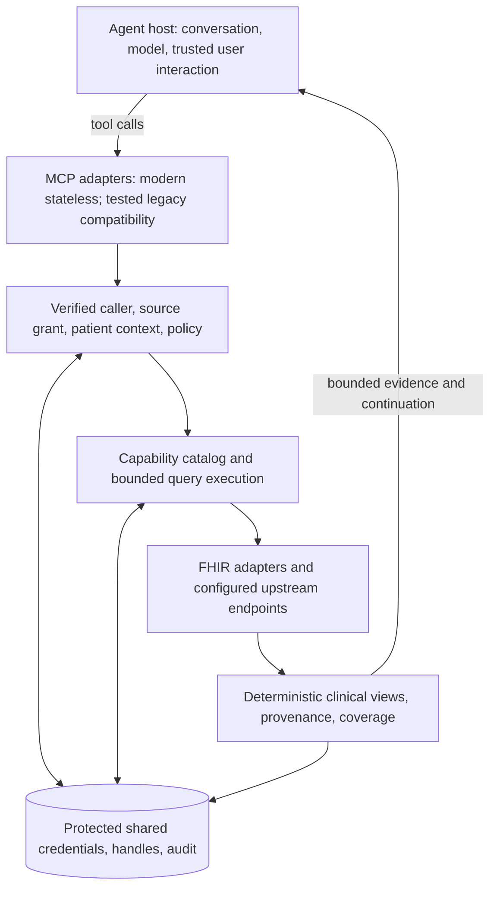

# FHIR MCP Gateway — product and architecture plan

**Revision:** 0.4.1 · **Date:** 2026-10-19 · **Review status:** revised through several rounds of independent design review; 0.4.1 adds only the [duplicate-predicate amendment](proposals/m3b-exact-duplicate-compatibility-amendment.md) to §6 and §9.

This document proposes a build. Tool names, limits, delivery estimates, and acceptance targets are design decisions, not implemented capabilities or measured results. The original independent proposals remain in [proposals](proposals/); research is summarized in the brief, with decisive facts checked in the verification note.

## 1. What we are building

**A portable gateway that lets an MCP-capable agent discover, retrieve, and cite the FHIR evidence its user or service is authorized to access.**

An agent asks through a small set of tools. The gateway discovers what a configured FHIR endpoint actually supports, enforces the caller's access, executes bounded queries, and returns useful facts with source references and an honest statement of coverage. The same tool names work across resource types and tested vendors.

“Any resource” means any supported FHIR resource type allowed by the deployment and upstream grant. Reading an uncommon resource should work without adding a new tool. Rich clinical views are supported for a smaller, explicitly tested set of resource types. Authorized FHIR-shaped JSON remains available for deeper inspection, with explicit labels for policy redaction, projection, and payload omission under §6's workflow-specific boundary.

The first users are **healthcare agent developers and interoperability teams**. Their first successful experience should be: install a pinned package, connect a synthetic endpoint, attach an MCP host, and retrieve a patient's recent lab evidence with citations in under ten minutes. A production connection adds real identity, SMART authorization, organization policy, and operating requirements.

The launch promise is **correct authorized retrieval with predictable context use**. Measure it through evidence fidelity, completeness reporting, patient isolation, named backend compatibility, and task success. Keep these features available in an Apache-2.0 core. Support, private deployments, and a later managed offering can fund maintenance.

### A concrete example

A user asks, “Show this patient's recent HbA1c results.” The host supplies a previously selected patient context. The agent discovers the endpoint's Observation search capabilities, resolves the intended terminology, then searches that patient with an explicit date window and supported descending clinical-date sort. The gateway returns values, units, dates, status, and record/version references. If more pages remain, it provides a protected continuation. If the search fails, ordering is unverified, or access is limited, the response states that limitation. The agent composes the explanation from that evidence.

## 2. Why this product could earn adoption

FHIR MCP is already a populated category. [WSO2](https://github.com/wso2/fhir-mcp-server) documents a portable gateway and FHIRPath filtering; [Medplum](https://www.medplum.com/docs/ai/mcp) documents a general request tool and compatibility tools; [AWS](https://awslabs.github.io/mcp/servers/healthlake-mcp-server) and [Google](https://docs.cloud.google.com/healthcare-api/docs/tutorials/pre-built-tools-with-mcp-toolbox) provide cloud-specific integrations. [LangCare](https://github.com/langcare/langcare-mcp-fhir) documents several backend integrations, while [fhirHydrant](https://github.com/faulkj/fhirHydrant/) already combines SMART, metadata, compact results, paging, terminology, and audit features.

Our differentiator must be **a maintained, independently inspectable reliability contract**. A compact response is valuable only when it preserves meaning; a multivendor claim is valuable only when the named combinations are tested. Compare implementations under equivalent authorization, tasks, and budgets before making superiority claims. Repository descriptions establish advertised features, not verified production assurances.

The first release competes on patient-bound, read-only evidence retrieval. It does not claim leadership in population extraction, clinical write automation, unrestricted FHIR administration or document analysis. The public quickstart and support matrix say “document metadata only” until the selected, separately gated text-note module is implemented. Evaluate first-partner tasks against host-bundled alternatives, including whether structured evidence alone meets the workflow. If not, choose the already specified bounded text-note slice or a different first workflow; do not market metadata as note retrieval.

Maintain a dated comparison, linked to current first-party documentation, of host-bundled healthcare connectors and portable FHIR gateways. Identify the covered host/backend/workflow and the portability or evidence gap the first design partner actually needs. Availability and advertised read-only behavior are not independent conformance evidence. Choose a first workflow with a documented unmet need. v1 accepts no raw host token or arbitrary URL passthrough, including SHARP-style context; any later allowlisted adapter must preserve separate grants, trusted context and egress policy.

Before substantial implementation, inspect extension/fork options for the closest open-source projects. Choose reuse when their license, maintenance, and architecture support our contract. The first milestone records that decision; a greenfield implementation is an option, not a prerequisite for success.

| Initial workflow | Evidence needed | v1 behavior |
| --- | --- | --- |
| Answer a question about one patient's records | Observations, conditions, medications, allergies, encounters | Narrow authorized search/read with citations and partial-data signals |
| Prepare a bounded chart overview | Versioned recipes over the selected workflow’s reviewed clinical sections | Deterministic facts; separate coverage and continuations for each section |
| Explain a lab/vital trend | Correct codes, components, units, clinical dates, statuses | Preserve original values and semantics; disclose time window and gaps |
| Debug an integration | Capabilities, parameter definitions, profiles, operation outcomes | Explain supported/unknown behavior and repair malformed queries |
| Assemble referral or payer evidence | Coverage, EOB, ServiceRequest, documents' metadata and conditional note text under §6 | Generic authorized resource access; preserve clinical/claims provenance |

Interview twelve prospective users and recruit three design partners to test these priorities. Treat demand, willingness to operate the gateway, and maintenance funding as hypotheses until validated.

## 3. Scope and release sequence

Treat the eight tools as a candidate architecture and publish only implemented actions. Separately release a corrected, pinned synthetic alpha, a workflow-specific authenticated read-only beta, and an organizational remote pilot. M3a closes applicable security/fidelity/state/assurance defects; M3b supplies the first workflow's discovery and data usefulness. The external/model validation gate precedes expansion into remote/SMART implementation unless explicitly waived as development sequencing only. Begin interviews, EHR registration and partner choice early. History, general operations, all eight sections and optional extraction modules enter only when that workflow requires them and their own gates pass. Record every applicable gate as met, unmet or deferred with evidence; deferred is not passed. Distribution and support tiers describe exact tested versions and data flows, not production readiness inferred from synthetic results.

| Stage | Included | Exit |
| --- | --- | --- |
| **Corrected, pinned synthetic alpha** | Generic R4 capabilities/search/read, stdio, result contract, safe paging, local fixtures; M3a security/fidelity/state/assurance and selected-workflow M3b discovery/usefulness | Applicable deterministic gates pass; exact support and remaining limitations recorded |
| **Validation gate** | Unaided external quickstart and three retrieval tasks; opt-in two-model-family baseline with text-only and structured consumers; interviews and one selected partner/workflow | Evidence and gate status recorded under §9; any development-sequencing waiver leaves the gate unmet |
| **Workflow-specific authenticated read-only beta** | One selected SMART user or Backend Services path, remote identity, trusted patient binding, shared protected state and audit; only implemented workflow tools/modules | Applicable authorization, fidelity, transport, retention/revocation and operating gates pass |
| **Organizational remote pilot** | Selected organization/backend/workflow, reviewed data flows, named client integrations and operational exercises | All applicable security/fidelity/paging gates pass; one authenticated vendor workflow and three independently implemented client stacks have evidence |
| **v2 modules** | Bulk export/jobs, broader document-byte retrieval/extraction, more FHIR versions/backends, deterministic tabulation, limited approved writes | Separate contracts, threat analysis, fixtures, and partner demand for each module |
| **Later expansion** | Governed federation, event delivery, specialized payer/workflow packs, optional MCP Apps, managed multitenant hosting | Operating model and domain-specific evidence justify each addition |

v1 permits implemented FHIR read/search, plus workflow-required history or a small allowlist of verified non-mutating operations, each only after its own gates pass. It performs no upstream clinical create/update/patch/delete or transaction execution. Its own credential, audit, and short-lived result storage are necessary application state. This choice keeps the first release focused on the user's retrieval objective. Approval UX, write semantics, conflict detection, and execution recovery require a separate release boundary.

The first authenticated pilot implements patient-bound access, including provisioned service principals whose trusted job input establishes the patient binding. Grant-scoped unbound and population modes remain deny-by-default seams until separately threat-modelled, entitled and tested. Choose SMART user launch or SMART Backend Services from the validated partner workflow; payer UM/CDI may motivate the latter, but neither workflow label alone supplies entitlement. Implement only the selected path before expanding. In this plan, "first authenticated pilot" and "v1" mean the workflow-specific authenticated read-only beta and the organizational remote pilot built from it; every rule stated for the first authenticated pilot applies to both. When population access is later enabled, generic search serves only bounded authorized population queries; large extraction belongs in the later Bulk Data path.

Attachment metadata is available subject to authorization. Attachment/Binary bytes remain omitted in the synthetic alpha: every tool, retained result and resource read omits inline `Attachment.data`, `Binary.data` and other release/profile-declared payload-bearing base64 fields and supplies labelled metadata manifests under §6. The first authenticated pilot may enable only §6's separately configured, workflow-required and gated text-note exception; otherwise artifact-byte delivery remains deferred. The exception returns bounded labelled text, not generic byte access, and `output.format=fhir` cannot bypass the boundary. OCR, broader document conversion, open-ended graph traversal, automatic patient matching across organizations, and arbitrary code/SQL execution remain deferred.

## 4. Protocol and standards baseline

Use **MCP 2026-07-28** as the modern baseline. Its official [changelog](https://modelcontextprotocol.io/specification/2026-07-28/changelog) and [compatibility specification](https://modelcontextprotocol.io/specification/2026-07-28/basic/lifecycle) confirm removal of protocol sessions and initialization. Each request declares version/capabilities; the server implements `server/discover`. Follow the revision's result, transport-header, caching, and error requirements through the pinned official SDK and conformance tests.

Support stdio and Streamable HTTP. Keep the modern path stateless. Offer **2025-11-25 compatibility only through a tested adapter**, including its handshake/session semantics where required. A legacy session is transport state and never supplies identity, patient selection, or authorization. Maintain compatibility state outside replica-local memory where the selected legacy behavior requires it. Unsupported versions return actionable protocol errors.

The [official TypeScript SDK v2](https://ts.sdk.modelcontextprotocol.io/v2/) identifies itself as the stable line implementing the modern revision. Pin an exact version in the PLAN 0.3 and early-discovery phase; prove both eras with actual clients. If a single SDK process cannot serve the required legacy combinations, use separately pinned modern/legacy transport adapters over the same policy/query core, with isolated entrypoints and shared protected application state. Demonstrate this fallback in the early-discovery spike or reduce the supported legacy matrix explicitly. Basic retrieval depends on ordinary tools. Resources and prompts are conveniences; elicitation, Tasks, subscriptions, and Apps are optional and do not gate v1 retrieval. Sampling and other deprecated features are excluded from the gateway design.

| Standard area | Promise |
| --- | --- |
| FHIR | R4 4.0.1 first; R4B/R5 require separate adapter tests. R6 remains experimental while its release artifacts are pre-publication. Pin the precise package/version/digest and record its dated publication status using HL7's publication directory; snapshot boilerplate is not proof of ballot sequence or final approval. Preserve the source release; never silently convert. |
| SMART | Implement published [SMART 2.2.0 authorization/launch semantics](https://hl7.org/fhir/smart-app-launch/scopes-and-launch-context.html); negotiate legacy scope syntax only where the source advertises it. Scope strings are only one part of access control. |
| Profiles/IGs | Pin selected US Core/IPS packages by version and digest. Expose declared vs tested conformance. International generic FHIR access does not depend on US Core. |
| Later Bulk Data | Start from published [3.0.0 STU3](https://hl7.org/fhir/uv/bulkdata/en/index.html); evaluate newer ballots separately. |

## 5. Eight candidate core tools

Treat the eight tools as a candidate architecture and publish only implemented actions. Use stable names, deterministic listing order, concise descriptions, JSON Schema inputs/outputs, and synthetic examples. Resource types are dynamic strings validated against the source release and configured capabilities. Operator configuration determines the installed tool catalog; per-request permissions determine execution and discoverable capability details. Tools do not vary with an HTTP connection.

Common data-call arguments are `source?`, `context_handle?`, and `output?`. `source` is a configured alias, never a URL; it may be omitted only when unambiguous. A context handle identifies a trusted existing binding. Tenant, authenticated identity, role, credentials, arbitrary headers, and permission escalation are never model arguments. Handle-only tools derive source/context from protected state and reject conflicting selectors.

The optional spelling of `context_handle?` is conditional, never an authorization opt-out. Trusted deployment/delegation policy assigns each workload **patient-bound** or explicitly enabled **grant-scoped unbound** access. For patient-bound clinical calls, require an unexpired context handle. An omitted handle may be inferred only when trusted deployment fixes exactly one patient binding that cannot change for the entire lifetime of the verified inbound credential or delegation, such as fixed local stdio configuration, a fixed single-patient backend job, or an inbound credential minted for one selection or launch. If that credential's binding set can change, including a host connector shared across conversations, omission returns `CONTEXT_REQUIRED` even when only one binding is currently live. There is no per-principal current patient. An expired, revoked or superseded handle returns `CONTEXT_REQUIRED` and never resolves to another binding. Omission never selects unbound access or broader grants. Unbound clinical/population access remains denied in the first authenticated pilot; later enablement requires separately provisioned entitlement for that principal, workload, interaction, and resource class. No tool argument or omitted handle can select that mode. Shared metadata/catalog access follows §7's separate classification.

| Tool | Main inputs | Responsibility |
| --- | --- | --- |
| `fhir_capabilities` | `topic: sources/context/server/resource/search_parameter/operation/profile`, `resource_type?`, `name?`, `query?`, `cursor?`, `limit=20` | Discover only caller-visible sources/context and bounded source-specific definitions; include evidence, version, and freshness. No implicit clinical-data access. |
| `fhir_search` | `resource_type?`, `compartment?`, `params: [{name,value}]`, `page_size=20` | Type/compartment/system search where authorized. Return match/include distinctions, effective-query evidence, coverage, and continuation. |
| `fhir_read` | `interaction: read/vread/history`, `resource_type?`, `id?`, `version_id?`, `since?`, `page_size=20`, `resolve_paths?: string[]` | Authorized resource/version retrieval and configured history, subject to §6’s payload boundary. Read requires type/ID and vread requires type/ID/version through server-side validation; history can be instance/type/system only when explicitly enabled and confined under §7. |
| `fhir_page` | `cursor`, `output?` | Continue the original authorized query/history/operation, draining any retained page remainder before requesting the upstream next page. |
| `fhir_operation` | `level: system/type/instance`, `resource_type?`, `id?`, `operation`, `parameters?` | Execute only reviewed, configured non-mutating operations outside terminology. A discovered operation is not automatically executable. |
| `fhir_terminology` | `action: resolve/lookup/validate/expand/translate/subsumes`, `system?`, `code?`, `version?`, `text?`, `value_set?`, `concept_map?`, `count=20`, `offset=0` | Return bounded candidates or operation results with provider/version, match method, ambiguity/equivalence, and warnings. Supported actions are source-dependent. Patient-bound `codes_in_record` is added only when implemented and tested for the selected workflow under §6. |
| `fhir_patient_context` | Trusted `context_handle` (or a binding validly inferred under §5); optional `patient_id` is only a consistency check against that binding and never selects among bindings; `sections`, `since?`, `per_section_limit=10` | Assemble deterministic sectioned facts for the workflow-selected, reviewed sections drawn from problems, allergies, medications, labs, vitals, encounters, procedures, and immunizations; unimplemented sections are not advertised. It cannot establish patient identity from an agent's assertion. |
| `fhir_result` | `handle`, `action: inspect/project/page`, `columns?`, `offset=0`, `limit=20` | Inspect, project, or page a retained local snapshot. It does not fetch new upstream records. Initial projection accepts bounded supported field paths, without arbitrary execution or a general expression engine. Retention expires automatically; administrative cleanup stays outside the agent catalog. |

Server-side validation requires resource type and ID for read, and resource type, ID and version for vread. Missing fields return actionable `INVALID_ARGUMENTS` identifying safe field paths. Tool input schemas use an object root without root-level `oneOf`, `anyOf`, `allOf`, `if`, or `not`; conditional requirements are validated server-side. This host-compatibility profile does not prohibit the nested objects and arrays required by the tool contract.

For read/vread, references resolve only on explicit request, at most one hop and ten references, under independent policy checks. Contained references resolve within their container. External references remain unresolved unless their source and grant are separately configured. Preserve unsupported reference forms rather than guessing their target.

There is no unrestricted `fhir_request(method,path,url,headers)` in v1. Generic resource access comes from `read` and `search`; reviewed custom operations use `operation`. Backend adapters can add validated semantics without bypassing policy, egress, budgets, or audit. Keep clinical mutations in separate future tools with separate permissions.

Candidate v1 operations are a bounded patient `$everything`, a source-supported IPS `$summary`, and informational `$validate`. Each needs source-specific review/fixtures and an explicit allowlist entry; its `OperationDefinition` alone is insufficient. `$everything` is opt-in and never the default patient-context strategy. Clinical-resource deletion and model-facing deletion of retained snapshots are outside the v1 tools. Set accurate tool annotations, including `readOnlyHint`, and test runtime enforcement independently of those hints.

Each allowlisted operation has a typed, size-bounded input/output contract, including permitted targets, resources, and parameter cardinalities; do not pass an arbitrary `Parameters` object through unchecked. A resource submitted to `$validate` is an intentional disclosure to that source, subject to grant/context/egress policy, the input byte limit, v1 payload restrictions, and log scrubbing. The operation's result passes the same per-resource and payload checks as reads.

### Optional resources and prompts

| Surface | Content and boundary |
| --- | --- |
| `fhir-mcp://guide/search` | Bounded search rules and synthetic examples |
| `fhir-mcp://source/{alias}/capabilities/{topic}` | Protected source-specific metadata, same policy as discovery |
| `fhir-mcp://result/{opaque_handle}` | Protected retained manifest/content, same current authorization and audit as `fhir_result` |
| `fhir_find_evidence` prompt | Verify selected context, discover supported query, resolve codes, retrieve and cite evidence, disclose coverage |
| `fhir_review_patient` prompt | Request named context sections, distinguish empty/unsupported/denied/failed, retain evidence references |

List only stable help and authorized metadata globally; never enumerate patient records or result handles. Use modern `ttlMs`/`cacheScope` metadata correctly: patient/result reads are private with no shared caching, and zero freshness TTL where appropriate. A resource URI is a protected locator, not a public download. The same workflow remains available through tools for hosts without resources or prompts.

Discovery cursors use the same opaque, expiring, authorization-bound snapshot machinery as result cursors, with no patient binding where the metadata is non-patient-specific; continue them through `fhir_capabilities(cursor)`. Clinical query cursors continue through `fhir_page`. Terminology offsets follow the provider's declared expansion/version semantics; local `fhir_result` offsets address a retained snapshot. Neither offset permits a new source or query, and provider changes across pages are disclosed.

### Search correctness

Represent parameters as ordered pairs to preserve repetition. Preserve FHIR escaping, comma OR, repeated constraints, date prefixes, token systems, quantities, canonical versions, composites, chaining, `_has`, and include modes. Encode once at the HTTP boundary. Required patient constraints are generated from trusted context and cannot be replaced, contradicted, or broadened by model arguments.

Use source-specific `CapabilityStatement`, `SearchParameter`, `OperationDefinition`, pinned release/IG definitions, and tested vendor overlays. Mark capability evidence as `declared`, `observed_supported`, `observed_unsupported`, or `unknown`, with timestamps. Metadata can be incomplete; support unknown vendor parameters only through an approved overlay or controlled synthetic probe.

[FHIR R4 permits ignored unsupported parameters](https://hl7.org/fhir/R4/search.html). Request `Prefer: handling=strict`, inspect warnings/self links, and use adapter conformance evidence. A self link alone is not proof of filter execution. If a material clinical filter is uncertain, return unknown/partial coverage or fail the request. If an authorization constraint cannot be enforced, fail closed before disclosure. Never “repair” a query by dropping patient or policy restrictions.

Prefer POST `_search` for sensitive parameters where supported; scrub request bodies and URLs from infrastructure logs. If an endpoint requires GET, configure equivalent transport/log protection. HTTP POST is not intrinsically a write; operation semantics, independent policy, and allowlists determine permitted behavior.

Preserve `entry.search.mode` and count primary matches separately from included resources. Wildcard/iterative includes are off by default. Any approved traversal has explicit hop, resource, call, and byte limits. Unsupported joins return a bounded alternative; unbounded patient enumeration is never an automatic fallback.

Return requested and effective `_sort` plus its evidence. If sorting is absent or unverified, label order unspecified; the first page cannot be described as the latest results. A bounded date filter alone does not establish recency order.

Classify sanitized OperationOutcome issues by code, expression and tested source semantics as well as severity. Filter-related uncertainty can arise at informational severity; a warning is not automatically a failed query. Keep requested constraints, source-reported constraints and independently verified execution distinct. A self link alone never establishes `executed_constraints`; populate that field only for constraints the gateway enforces or a tested adapter proves for the declared source/version. Unknown execution produces an explicit limitation, never an assertion of a negative clinical finding.

While `codes_in_record` is absent, use a bounded patient-bound `fhir_search` with `output.fields=['code']` and the ordinary page/work/byte limits to inspect observed codes. Return partial coverage when the scan is capped; an output limit alone does not bound a full-record scan.

## 6. Output, paging, and clinical fidelity

Every ordinary tool result has a versioned application envelope in `structuredContent`. Text-only and unknown host profiles receive the bounded application envelope serialized as text alongside structuredContent. A tested structured-host profile may use concise text only when evidence and all required continuation/error state still reach its model. Define the byte allowance over the final serialized MCP tool-result value, including era-specific result fields, SDK-added metadata and all content duplication; exclude only the separately reported JSON-RPC framing/transport overhead. Admission and fallback error shaping must meet that allowance. Verify it from captured wire bytes in both declared eras, not by reusing core accounting in the eval verifier. MCP's protocol-level `resultType: complete` describes request completion, independently of this envelope's data coverage.

Name and version each tested output-delivery profile. A structured-host profile is enabled through trusted operator/client configuration only after a captured host trace proves the model receives the clinical evidence, source/context, coverage limitations, citations, continuations, retained-handle expiry, warnings, payload manifests and errors needed for the advertised workflow. Provide a concise evidence rendering where the host requires text, with no second full envelope unless needed. If structured delivery is absent or unverified, use the full bounded text profile. Measure final wire bytes and actual model-visible tokens separately. Profile negotiation never relies on an agent's unsupported claim about its host.

| Field | Required meaning |
| --- | --- |
| `schema_version`, `request_id` | Application schema version and opaque audit correlation |
| `source`, `context` | Source alias/FHIR release/capability revision; used context handle, policy-permitted user-recognizable label and policy revision |
| `data` | Tool-specific facts, authorized FHIR-shaped JSON, metadata, typed rows, or manifest; all policy/payload transformations explicitly labelled |
| `provenance` | Source/type/id/version where available, retrieval time, protected references; links from facts to evidence |
| `coverage` | `state: complete_for_query/partial/unknown`, scope, reasons, executed constraints, pages observed, authorization-limit caveat; section-specific when composite |
| `pagination` | `has_more: true/false/null`, continuation, returned match/include counts, optional total with `accurate/estimate/unknown` precision |
| `transform` | Format, projection/omission, narrative omission, subset status, recipe version, unresolved interpretation limits |
| `warnings`, `error?` | Structured safe codes/messages and bounded repair guidance; sensitive upstream diagnostics scrubbed |
| `budget`, `result?` | Serialized bytes/limit, upstream calls, elapsed time, limit reached; retained handle, expiry, available formats |

Use `complete_for_query` only when the authorized query is exhausted and its material constraints were actually enforced. An exhausted query means no further page was advertised for the authorized query as observed. Unknown execution is an explicit limitation. Neither exhaustion nor query completeness establishes that the patient’s entire history exists in that source, that upstream ACLs returned every record, or that other organizations were queried. Empty, unsupported, denied, failed, and not requested are distinct section outcomes. Report only authorization limitations/counts the caller may know.

Withhold upstream totals until their disclosure is proven safe for the full authorized result, including unfinished or suppressible searches. If any upstream entries are suppressed by gateway authorization checks, suppress upstream total values in every format, including raw Bundle views; total precision is unknown. Returned match/include counts cover delivered entries only. Continuations advance over the actual upstream position and retained authorized remainder without claiming suppressed entries were delivered. Empty authorized pages may still have a continuation. Do not publish suppression-dependent caveats that reveal prohibited relationships. Direct requests for unauthorized/cross-patient targets use the same public response shape as not-found, without revealing existence, withheld counts, target identifiers, or policy details. Malformed, oversized or otherwise unverified direct-read responses must not expose existence before linkage is established; keep precise protected diagnostics and bounded linkage checks. Internal audit records the actual reason. Resource-class rules and their test cases are in §7/§9.

Ordinary resource-path continuations retain every distinct exact decoded material constraint under the [reviewed duplicate-predicate amendment](proposals/m3b-exact-duplicate-compatibility-amendment.md); frozen requested evidence and the initial outbound query retain every original occurrence; paging-size variation is allowed only as specified by the adapter. An opaque paging form may omit those constraints only through a tested query-bound adapter. Never fetch a broadened query and rely on post-filtering to restore confinement. If a next link is unsupported or unsafe but the completed page can independently be validated and sanitized, return that safe evidence as partial, with no usable next cursor, `has_more:null` and a non-continuable reason. Never equate a rejected continuation with exhaustion. Withhold upstream totals until their disclosure is proven safe for the full authorized result; do not publish suppression-dependent caveats that reveal prohibited relationships.

Govern raw Bundle links as well: keep continuation locations server-side and expose opaque cursors in `pagination`; omit unsafe or secret-bearing links from the FHIR-shaped view and label the change. Raw format cannot bypass policy, total suppression, payload omission, or protected-link handling.

### Starting limits

These defaults are adjustable downward by an administrator and must be tuned using measurements.

| Limit | Initial default |
| --- | --- |
| Tool input | 256 KiB argument ceiling, with smaller typed limits per operation; transport/schema limits are enforced before unbounded parsing |
| Inline output | 24 KiB default; 128 KiB hard ceiling for the serialized tool result, including text duplication. Caller-requested `max_bytes` cannot exceed the deployment ceiling; reject unusably small budgets with a small error. |
| Pages | Request 20 primary matches; at most 100 delivered primary matches/page; included resources share the byte/resource budget. Upstream `_count` is a request, not a guarantee. |
| Upstream work | 20 upstream requests max/composite; each request, including token work, ≤30 seconds and the remaining tool budget; overall deadline defaults to 45 seconds with a 200-second hard ceiling, reduced for the tested host/caller |
| Network input | 5 MiB compressed / 20 MiB decompressed per upstream response; streaming limits and bounded parser memory |
| Temporary retention | 15-minute TTL from creation, never extended by reads; 10 MiB/caller quota plus deployment storage ceiling. No long-term clinical cache by default. |
| Context overview | Ten facts/section; explicit 90-day window for labs/vitals/encounters; versioned current-status recipes for problems/allergies/medications; actual filters returned |

An overall non-streamed tool deadline defaults to 45 seconds and has a 200-second hard ceiling, further reduced to fit the tested host profile and caller deadline with response-finalization headroom. It includes admission waiting, token acquisition, discovery, upstream calls and rendering. Each upstream request, including token work, is bounded by the smaller of its configured timeout, 30 seconds and the remaining tool budget. Propagate caller cancellation. Shared flights keep their own bounded lifetime; one waiter's cancellation does not cancel work still needed by another authorized waiter. At deadline, stop new work and return completed authorized sections as partial when such a result is useful and fits the envelope; otherwise return a safe timeout. Do not retain or audit an undelivered cancelled result as a disclosure. Longer work requires an explicitly enabled, tested host/transport profile with request-scoped SSE progress and a separately bounded duration; an open SSE connection alone does not waive limits.

`output` selects `compact`, `fhir`, or `table`, with bounded field selection and `max_bytes`. Byte limits are enforceable; token estimates depend on the host/model tokenizer. Preserve authorized values and number precision in retained representations after policy/payload processing; compact numeric values preserve the original decimal lexeme; a normalized interim view is labelled and never claimed as full fidelity. Use an exact/untransformed label only when no gateway transformation occurred.

**Payload manifests apply in every format.** Outside the separately configured text-note exception below, remove inline `Attachment.data` wherever the datatype occurs, `Binary.data`, and equivalent release/profile-declared payload fields before model-visible serialization or result retention. Keep only authorized metadata: content type, source-provided size/hash where available, resource identity, payload location, and a protected locator if an approved retrieval path exists. Emit manifests separately in the envelope with `transform` paths/reasons; never insert a non-FHIR object into a base64 field or claim byte-exact JSON after omission. Suppress data URLs and secret-bearing attachment links rather than leaking bytes/capability URLs through another field. Do not fetch external attachment URLs; native Binary bodies are unavailable outside the narrowly gated same-source note path. An authorized generic Binary read returns a metadata manifest; R4 Binary has [no standard search interaction](https://hl7.org/fhir/R4/binary.html), so unsupported search is reported, while any Binary encountered through a supported adapter/Bundle receives the same treatment. Metadata itself still requires resource authorization; a manifest does not bypass §7. Parsing remains bounded even when an upstream JSON response embeds a large payload. Safe attachment locators may be opaque protected references without publishing a capability URL.

Attachment/Binary bytes remain omitted in the synthetic alpha. The first authenticated pilot may enable a separately configured text-note slice only when its selected workflow requires it and its authorization, fidelity, transport and injection-canary gates pass. The initial slice is limited to explicitly supported `text/plain` and a reviewed safe HTML-to-text subset from patient-linked DocumentReference or DiagnosticReport.presentedForm through an allowlisted same-source retrieval path. Every artifact and Binary lookup independently verifies source, patient linkage, applicable securityContext, grant and current policy; a reference is not permission. Output is labelled `untrusted_text`, bounded by fetch/decode/text/final-wire budgets, and carries resource/version/attachment provenance and any truncation or decoding limitations. No arbitrary/external URL retrieval or generic Binary access is enabled. RTF, C-CDA, PDF, OCR and other extraction formats remain separate later modules. If the selected workflow does not require note text, v1 retains metadata/manifests and the note slice stays Later.

When a page is larger than the inline allowance, retain its authorized remainder and return a cursor. Drain it before following the upstream link. A cursor is an opaque high-entropy locator, bound to principal, client, source, grant, patient context, query, projection permissions, policy epoch, position, and expiry. Reauthorize every use; possession is never sufficient. Never accept model-supplied next-page URLs.

If a resource cannot fit, return a manifest and field-selection/retention guidance. If storage or network limits prevent retaining the remainder, fail or explicitly mark non-continuable partial coverage; never claim lossless pagination or issue a cursor that skips records. Cursor replay is stable for a retained page; upstream search changes may prevent snapshot consistency across later pages. State that limit and deduplicate without hiding distinct history versions.

Count retained backing data once rather than charging it again for each cursor/page. Reclaim quota without silently losing records or invalidating live continuations; if retention is unavailable, use the explicit non-continuable partial/failure path above. Purge expired resource bodies while idle, not only on the next request. Test quota recovery and no-loss continuation at the retention boundary.

### Compact views preserve meaning

Use deterministic versioned extraction. An Observation includes relevant code/system and component labels, value/unit, effective time, status, reference range/interpretation/data-absent reason when applicable, and evidence references. Medication facts distinguish ordered, reported, dispensed, and administered evidence. Conditions retain clinical and verification status. Do not automatically convert units, collapse differing assays, flatten blood-pressure components, or infer that absence means a negative clinical finding.

Every projection, including selected fields and retained projections, preserves the modifier semantics and primitive companions needed to interpret the facts it returns. Consult pinned release/profile definitions, including built-in `isModifier` elements and extension-only primitives. If required meaning cannot be safely represented, return an explicitly uninterpreted structural view or refuse that clinical projection. Unknown modifier extensions, implicitRules, and policy-withheld modifiers prohibit a confident clinical interpretation. Use reviewed, versioned type-specific recipes; `isSummary` is only a baseline and requires a safety supplement. Unsupported recipes fall back to bounded sanitized FHIR/structural evidence, with omission labels. Preserve original numeric/date representations and never claim full fidelity for a normalized interim view. Preserve original date precision/timezone, source version, and upstream `SUBSETTED`. Projected JSON is labelled and cannot later serve as a full replacement resource.

A compact recipe is a measured output profile, not merely a field-removal algorithm. For every advertised workflow, publish paired FHIR/compact/selected results using the same sanitized evidence, final MCP result accounting, host delivery profile and pinned reference tokenizers. Preserve all critical facts and interpretation context. If the compact profile is not smaller on its declared target workload, label that limitation and use the better supported profile by default for that workload; do not claim token efficiency. Recipe/profile metadata may be deduplicated only when the delivered envelope remains self-describing and omissions remain inspectable without fetching the original clinical body.

Versioned context recipes declare the clinical date element and overlap/precision rule per section, rather than treating record-update time as clinical time. Current sections exclude entered-in-error/refuted evidence according to documented rules and disclose exclusions safely. An explicit no-known-allergy assertion remains distinct from an empty/missing allergy section. These rules receive clinician-reviewed fixtures, including corrected results and historical status changes.

Terminology resolution returns candidates, not assumed equivalence. Pin system/version/value set where available; retain inactive/abstract flags and mapping equivalence. On failure, return uncertainty rather than fabricated codes. External terminology egress is separately approved; credentials, patient identifiers, and whole notes are excluded. Ship no licensed terminology dataset without appropriate permission.

A filtered zero result may return a non-diagnostic `NO_MATCHES` hint: the executed query found no delivered matches, which does not establish absence of the clinical concept. Offer bounded code discovery and safe query-repair guidance. A patient-bound `codes_in_record` action, when implemented for the selected workflow, returns distinct observed system/code/display tuples by supported resource type with provenance, bounded upstream pages/work/bytes, protected continuation and partial coverage whenever scanning or output is capped. It is clinical-data access and never runs through metadata-only `fhir_capabilities`. Terminology services do not receive patient identifiers or whole notes.

## 7. Architecture and authorization



For a greenfield implementation, use TypeScript, strict typing, Node 24 LTS, official MCP SDK v2, and a small HTTP framework for callback/health/admin endpoints. This is the preferred default, not a prerequisite that rules out a better reuse/fork option: the early-discovery reuse/fork assessment precedes the final stack pin and records any change. Keep core query/policy/result logic independent of MCP transports. Select the FHIR client only after proving repeated-parameter encoding, streaming limits, redirect control, transport hooks, and per-grant token isolation; use a narrow native HTTP adapter where a library cannot meet those requirements.

Use release-specific FHIR types for development, runtime schema validation for tool contracts, and the HL7 validator for pinned fixtures/profile checks. Types alone do not establish resource conformance. Initial projections are bounded field paths; add a constrained FHIRPath engine only when measured demand justifies its parser/runtime limits. CPU-heavy extraction belongs in later isolated workers.

### Two authorization relationships

1. **Host → MCP gateway.** Validate the access token for this MCP resource, including issuer, audience/resource, expiry, client, and effective authorization. Use the revision’s protected-resource discovery and maintained authorization-server integration. Support pre-registered clients and CIMD; permit DCR only as a tested fallback for named hosts. A single-organization deployment normally uses its organization's IdP as the MCP authorization server or a maintained server federated to it. Headless access uses AS-issued tokens mapped to provisioned service principals; private-key client authentication is preferred where supported. Static shared API keys are not accepted as inbound MCP authorization. An enterprise-managed authorization profile is optional and separately tested. Invalid or expired credentials receive a 401 challenge; valid credentials lacking authorization receive the applicable 403 `insufficient_scope` challenge with the complete scope set required for that operation, not every possible scope. Validate the token audience against the canonical MCP resource identifier. `clientInfo`, request IDs, and caller-supplied agent labels are untrusted descriptions.
2. **Gateway → upstream FHIR.** Obtain a separate SMART user/patient grant or a deliberately provisioned service grant. Keep tokens/refresh credentials in a protected vault. The inbound MCP bearer is never blindly forwarded to FHIR; no model argument carries credentials. Cloud-native IAM/SigV4 integrations use explicit adapter identities and equivalent local policy.

If the MCP authorization server federates to an upstream authorization server under a static client ID while accepting CIMD or DCR clients, it implements the specification's per-client consent controls (per-user approved-client registry, consent UI, `__Host-` client-bound cookies, exact redirect matching, state set only after consent) before forwarding.

Bind tenant, verified human/service subject, authenticated MCP client/delegation identity, source, upstream grant, patient/workload context, and policy on every request and retained-result access. Requested scopes do not prove granted scopes. [SMART explicitly permits additional underlying restrictions](https://hl7.org/fhir/smart-app-launch/scopes-and-launch-context.html), so local policy and upstream permissions both apply.

The default user flow is an authorization broker with server-side SMART tokens. Linking starts at a gateway-hosted connect URL, never directly at the upstream authorize endpoint. The URL contains only an opaque, single-use, short-lived reference to a server-side record bound to the initiating tenant, verified MCP principal, authenticated client/delegation, and intended source. It carries no credential, patient identifier, or pre-authenticated grant. The connect page authenticates the browser user through the MCP identity provider and compares the authoritative issuer-qualified subject and tenant, or a configured verified canonical-subject mapping, with the initiating principal. An email match or possession of the URL is insufficient. Mismatch, expiry, replay, or tampering fails without binding a grant. The link record is consumed atomically for initiation; callback completion is separately single-use and bound to that verified flow.

Create OAuth state only after the identity check and bind it to the principal, client/delegation, source, expected issuer, token endpoint, redirect URI, and PKCE verifier. Validate state, PKCE, exact redirect URI and source on callback. Validate a returned issuer against the recorded issuer without URI normalization; reject missing `iss` when issuer-response support was advertised. If `iss` is not advertised and is absent, require the tested per-source redirect-URI and state/endpoint binding that prevent issuer mix-up. Store the grant, granted scopes, and validated upstream identity claims when supplied against the verified principal. Enforce any configured principal-to-`fhirUser` mapping at link time and whenever refresh or re-link supplies identity evidence; a mismatch fails closed. Refresh responses need not fabricate identity claims they do not carry.

An EHR-initiated launch initially creates only an unbound, short-lived pending record. Claiming it requires authenticated proof linking the EHR launch user to the claiming gateway principal, through tested SSO or a verified identity mapping. A single-use claim code locates the record but is not proof of same-user identity. If this proof is unavailable, no gateway context is created. Hosts declaring URL-mode elicitation may receive the connect URL in an MRTR `input_required` result. Its `requestState` is integrity-protected and bound to principal, client/delegation, request digest and expiry; single use is enforced in protected server-side state. Other hosts receive `CONNECTION_REQUIRED` with the same safe connect path. An elicitation acceptance is not proof that linking completed. New credentials never pass through model text.

### Establishing the patient context

Prefer a SMART launch-selected patient. Otherwise, an authenticated trusted host/control UI records the human's selection from authorized candidates and mints a server-side context. The UI/API is separate from model tool arguments. An agent may retrieve minimal candidates under an explicit patient-discovery permission, but a name match or tool-supplied `patient_id` cannot assert human confirmation.

Each selection or SMART re-link mints a new handle. A handle's source, patient, principal/client/delegation and grant-binding identity are immutable; it is never re-pointed to a different target or silently widened. Current authorization is rechecked on every use and may narrow access or revoke the handle without changing that target. Handles reach the conversation through a trusted human/host path. Listing existing authorized bindings is discovery, not confirmation of which patient the human intended for a particular conversation; a model's choice among them is not human confirmation. Supply a policy-permitted user-recognizable label and echo the used handle and that label in patient-bound envelopes. A caller-supplied thread name creates no new authorization boundary.

For an approved backend workflow, the service principal's policy and trusted job input define its allowed patient/workload set. A broad service token does not authorize arbitrary callers to impersonate a clinician. Generic reads/vreads, history, includes, operations, references, handles, and resource links all apply §5's policy-assigned mode and trusted context. Use tested upstream confinement plus resource-level checks; a `patient=` string or compartment path alone is not an authorization boundary. If a required authorization constraint cannot be safely executed, reject the query rather than fetch a broad set and repair it by filtering.

Patient selectors are consistency checks only. A supplied Patient compartment ID, `patient_id`, Patient read/vread/history ID, or Patient `$everything`/`$summary` instance target must match the binding. A clinical resource's logical ID (for example `Observation/obs-17`) is **not** a patient ID: authorize that resource/version through its declared subject-linkage predicate before disclosing it. A conflicting context handle, patient selector, or operation parameter cannot establish or switch context. Other operation targets/inputs obey their typed linkage rules. Instance history checks every historical entry/version; ambiguous/deleted entries cannot leak identifiers or counts. Type/system history is denied in patient-bound mode unless an adapter proves upstream patient confinement and per-entry authorization for that interaction; it is never an implicit broader fallback.

### Resource authorization classes

Store classifications and linkage tests by FHIR release/profile in versioned adapter data. Start from the [FHIR patient compartment](https://hl7.org/fhir/R4/compartmentdefinition-patient.html), which includes relationships such as performer/recorder as well as subject; membership alone does not prove that a resource is about the selected patient.

| Class | Patient-bound rule |
| --- | --- |
| **Patient-linked** | `Patient.id` must equal the selected patient. Each other supported type has an explicit clinically appropriate linkage predicate, such as `Observation.subject`, `Condition.subject`, `AllergyIntolerance.patient`, or the adapter's tested equivalent. Reference equality resolves within the configured source/authorized mapping; an unrelated patient acting as recorder/performer does not qualify. Multi-subject/nested entries require defined containment/redaction rules or denial. |
| **Shared/reference** | Definitional/catalog records, such as configured Medication, Organization, and Location profiles, may be accessed under grant and local policy without a patient link. A type name alone does not establish that an instance is safe/shared; profile, extensions, field policy, and source provenance can require stricter classification. |
| **PHI-bearing or ambiguously linked** | Deny by default in patient-bound mode unless an adapter supplies a tested linkage/authorization rule. Initial examples include Person, RelatedPerson, Group, AuditEvent, Provenance, and Binary. A Binary's `securityContext` may participate in a reviewed authorization rule; its manifest remains protected. Unknown types/profiles use this conservative class until configured. |

Each shared-instance policy is explicit and versioned by source/release/profile and specifies relevant extension/field constraints. Unclassified instances remain denied. The same predicate applies to read, search, includes, contained resources, operations and retained snapshots. Any per-path omission rule must preserve required modifiers and dependency semantics, label the resulting partial resource, and pass positive/negative fixtures. Do not infer shared safety from a resource type name.

Grant-scoped unbound access remains denied in the first authenticated pilot. Later enablement still needs the upstream grant, explicit local resource/interaction entitlement, field/egress policy, and audit. Returning a shared record does not authorize traversing its references into patient data. Apply the same classes to included resources, retained snapshots, and all operation outputs. When post-checks suppress entries, use §6’s count/total/error rules in every output format.

v1 preserves relevant `meta.security` labels and provides explicit policy hooks; it does not generically interpret every label vocabulary or execute arbitrary `Consent` provisions. Deployments requiring segmentation/consent enforcement must use tested upstream enforcement or a configured policy adapter, with allow/deny fixtures. The presence of a Consent resource is not itself an enforcement mechanism.

### State and concurrency

Modern requests may land on any replica. Store credential/grant bindings, context records, cursor/remainder data, policy epochs, and disclosure audit in protected shared stores. Use PostgreSQL for remote durable state and encrypted short-lived result storage; add Redis for distributed admission/rate limiting only if necessary. Larger object storage is a later opt-in. Local stdio treats the authenticated OS user as its local principal, keeps upstream grants separate, and can use an in-memory result store; its handles expire on restart. Never bridge that shared stdio identity into a network service; remote access uses the authenticated HTTP deployment.

Serialize token refresh per grant with a distributed lock/version check; handle refresh-token rotation without cross-user reuse. Reauthorize cached/retained content, expire and purge handles, apply local revocation/policy changes immediately, and document the upstream revocation detection window. A remote system cannot promise instant detection when the issuer supplies no revocation signal.

A resource-level 403 without an authenticated `invalid_token` signal produces the same public unavailable response as 404, without invalidating unrelated handles, capabilities, or the token. A 401 or validated `invalid_token` response invalidates only the credential generation that made that request. Confirmed grant revocation, loss of required authorization, or an explicit policy update still immediately invalidates affected retained access. A metadata 403 fails that metadata operation; it is not by itself proof that the token is invalid. An adapter may escalate it to connection-level denial only under a documented, tested source contract. Current authorization is rechecked on every retained access; retaining cache state is not permission to bypass a known restriction.

Bind invalidation to the credential generation used by the failed request. Late failures and superseded shared flights must not invalidate a newer generation or re-invalidate replacement work. Key discovery/cache flights by credential/policy epoch and bound retries of superseded work. Apply §6’s idle expiry purge and quota/no-loss continuation rules.

Apply fair admission by tenant, verified principal/client, and upstream source/grant. Bound concurrency, queue length/time, calls, bytes, and storage. Honor `Retry-After`; retry permitted reads only within deadlines with jitter. Do not retry indefinitely. Circuit breakers and cancellation stop wasted upstream work. Multiple agents sharing a valid principal share its quota and authorization ceiling; a claimed agent name cannot create a new identity or rate budget. Admission, token acquisition and transport share §6’s overall deadline and propagate caller cancellation; release admission slots and prevent orphan retention/disclosure. Shared flights retain their independently bounded lifetime for other authorized waiters. A particular FIFO implementation is not prescribed for the local alpha.

Stronger per-task isolation requires separately provisioned credentials or verifiable host delegation bound to the task/workload and context. A chat/thread name in tool arguments is insufficient. Callers sharing the same authenticated client, principal, and permitted context share that authorization boundary; document this rather than promising isolation the host has not supplied.

### Egress, prompt injection, and auditing

Administrator-configured sources define exact scheme/origin/base paths and expected issuers. Validate discovered/pagination/reference URLs, resolve relative links safely, block unauthorized redirects/credential forwarding, and guard DNS rebinding. Approved private EHR destinations are explicit; loopback, cloud metadata, and other unconfigured destinations remain denied. No arbitrary URL fetching tool is exposed.

Screen schema-typed URI and Attachment paths, primitive-extension paths, prose URL spans and omission manifests. Ambient proxy configuration must not redirect credentialed FHIR/token traffic outside deployment policy.

Treat notes, narrative XHTML, documents, terminology displays, and upstream diagnostics as untrusted data. Sanitize executable markup; preserve useful content with provenance. No retrieved text may change source configuration, grant access, alter tools, or invoke external actions. Deterministic processing reduces the attack surface, while host-side reasoning must still treat retrieved content as data.

Record allowed disclosures and denials in a restricted append-oriented audit ledger: verified actor/client, source, resource identities where authorized, interaction, policy decision, time, outcome, and request correlation. The ledger is itself sensitive. Keep it separate from operational logs, which exclude bodies, patient identifiers, full queries, credentials, and notes by default. Export FHIR AuditEvent to a separate configured sink where desired; do not require clinical-source write scopes for read-only operation.

For protected remote disclosure, durably record audit intent and disclosure before returning content; use a transactional outbox for later sink delivery. Fail closed if required durable audit storage is unavailable. Monitor and reconcile pending/failed events. Metadata-only synthetic demos can use a clearly labelled local audit mode.

## 8. Deployment and compatibility claims

Separately distribute a corrected, pinned synthetic alpha, a workflow-specific authenticated read-only beta, and an organizational remote pilot under §3/§10. Start with a pinned npm package and OCI image, a reproducible HAPI/Synthea demo, a `doctor` command, source configuration examples, and clear errors for missing grants or unsupported features. The organization-operated remote image adds TLS ingress, authorization-server integration, callback/control UI, vault/secret references, shared storage, restricted egress, and backup/retention procedures. The same code supports private cloud/on-prem deployment. Publish only implemented actions and describe exact tested versions and data flows; synthetic results do not establish production readiness.

Publish a machine-readable and human-readable workflow support matrix, versioned with each package. Distinguish source-advertised resources, gateway policy-supported interactions, conditional shared-instance access, reviewed compact recipes and clinical sections. The selected first workflow has an explicit minimal resource/dependency set and acceptance tasks. Installation and discovery expose that set before the first clinical query. Unsupported types remain denied; widening requires release/profile-specific linkage, contained-dependency, modifier and positive/negative fixtures.

Use these support tiers for every exact backend/version/profile/auth/client combination: **verified** (repeatable tests and evidence), **experimental** (partial evidence/known limits), or **unsupported**. This plan itself does not establish implementation, verification or certification of any combination. Raw JSON pass-through does not establish full release or profile support.

Target reproducible HAPI R4 and one independently implemented test server first. Start Epic and Oracle sandbox registration in the PLAN 0.3 and early-discovery phase; verify one authenticated vendor workflow for the pilot rather than promising both. Azure, AWS, Google, payer endpoints, and other EHRs follow partner demand and adapter resources. Capability differences belong in versioned adapter data/fixtures rather than opaque model prompts.

Test at least three independently implemented MCP host/client stacks; pin versions and record protocol era, transport, OAuth behavior, structured/text output, resource handling, and optional features. Client-specific `search`/`fetch` compatibility can be a separate opt-in adapter mapping to the same authorization/result core; it must not widen permissions or become an additional mandatory core tool; it maps onto the same implemented candidate tools. Public catalog listing and production PHI use require separate review of current host policies and the actual deployment data flow. Record actual host/version timeouts in the compatibility matrix and reduce tool deadlines accordingly; no unverified host timeout is a universal protocol fact. Before describing host portability, publish exact versioned host/transport/output/auth cells and the three retrieval tasks each passed. Prioritize the first partner's real host over speculative optional protocol features. A demanded older protocol era or search/fetch contract enters only through a separately pinned, tested adapter over the same core and authorization rules; unsupported eras remain explicitly unsupported until those checks pass. Catalog publication cannot substitute for a host test.

Deployers approve every processor receiving health data, including the host/model and transcript/log storage; verify applicable contracts, residency, retention, access controls, and incident responsibilities. An MCP server, test report, or open-source license does not itself establish compliance. Keep early public demos entirely synthetic. Shared multitenant PHI hosting remains a later operating decision.

## 9. Evidence that defines release quality

Use pinned Synthea seeds plus hand-reviewed synthetic edge fixtures. Run deterministic local CI; public sandboxes are non-gating smoke tests until a failure is reproduced in controlled fixtures. Include authorized positive cases alongside denies, so refusing everything cannot pass.

| Layer | Required proof |
| --- | --- |
| Protocol | Modern discovery/request/result/caching rules; declared legacy compatibility; stdio/HTTP; cancellation and overall deadline through admission/auth/transport, bounded shared flights, errors, output-schema validation, and independently captured final MCP result bytes including duplication/SDK metadata in both declared eras |
| Authorization | Wrong patient/principal/client/source/audience/issuer, missing/ambiguous/expired context, forged/conflicting selectors, alternate-patient `$everything`/`$summary`, history escape, broad service grant abuse, included/reference leakage, stale policy, revocation, token-refresh races, direct resource-link access |
| Egress | Malicious next links, redirects, hostname/path tricks, DNS/metadata destinations, external references, malicious diagnostics; typed URI/Attachment and primitive-extension paths, prose URL spans and manifests; startup and spawned-process checks that ambient proxy settings cannot redirect credentialed FHIR/token traffic outside policy |
| Query | Repetition/escaping, distinct exact material predicates on ordinary next links, with original requested multiplicity retained and controls governed by the reviewed duplicate-predicate amendment, query-bound tested opaque paging, strict-filter failure, wrong code, date/time precision, unsupported joins, match/include counts, version-specific definitions; OperationOutcome code/expression/source semantics at every severity; requested/reported/verified constraints distinct; Patient-targeting selectors validated before execution |
| Fidelity | Values/units/codes/status/components, primitive and modifier extensions, decimal precision, missingness, subset/narrative/projection labels, corrected/entered-in-error records; negated orders, nested modifiers, choice variants, extension-only scalars and aligned primitive arrays in every projection, including selected/retained views. A compact arm cannot exempt a workflow’s critical fact and then claim that workflow passed. |
| Resource classes and non-disclosure | Positive/negative fixtures for every supported linkage predicate and explicit versioned shared-instance source/release/profile/extension/field policy, including read/search/includes/contained/operations/retained snapshots; ambiguous-type denial, non-subject compartment membership, dependency/modifier-safe labelled omissions, unsafe totals withheld across unfinished/suppressible searches in every format, delivered-only counts/continuations, no suppression-dependent relationship signals, indistinguishable denied/not-found and unverified direct-read failures; if §6's text-note slice is enabled, not-found-indistinguishable denial of unlinked, cross-patient or securityContext-denied artifact/Binary lookups |
| Payload boundary | Inline Attachment/Binary/declared base64 payloads omitted in compact/FHIR/table, operations, retained results, nested Bundles, and resource reads; metadata-only manifests preserve authorization; no data/capability-URL bypass or generic native-binary fetch. If §6’s conditional text-note slice is enabled, explicitly test that narrow exception’s typed formats, same-source artifact/Binary authorization and securityContext, fidelity, fetch/decode/text/final-wire budgets, provenance/limitation labels and injection-canary gates. No universal omission claim applies to its authorized decoded text. |
| Paging/limits | Oversized page and single resource, remainder exhaustion, replay/expiry, idle expiry purge, backing data counted once, storage quota failure with an explicit non-continuable/failure outcome, storage quota recovery/no-loss live continuation, decompression limits, unsafe/unknown totals, changing upstream pages, partial fan-out; safe page-1 evidence with no cursor, `has_more:null` and a non-continuable reason after rejected continuation; deadline/cancellation and slot release |
| Operations | Every allowlisted operation's read-only behavior; all mutation paths rejected; audit outage behavior and confidential audit sink |

Authorization proof also includes: test account-link and EHR-launch completion by a different browser user; replayed, expired, tampered and cross-principal/client/source connect references and `requestState`; mismatched configured upstream identity at link, refresh or re-link; issuer omitted with and without advertised issuer-response support; and a pending launch claim code presented without same-user identity proof.

Authorization proof also includes: test two conversations sharing one inbound credential; addition and expiry of bindings, including A expiring while B remains; explicit old-handle use after revocation or supersession; omitted handles while the binding set can change; and local fixed-binding inference. No case may silently substitute another patient. Test policy/grant narrowing without target mutation.

Authorization proof also includes: test 403-versus-404 responses and subsequent handles, token acquisitions, FHIR-call counts and a concurrent authorized read. Exercise metadata-403 source-contract escalation only where documented and tested. Hold old-generation requests across token replacement and prove late failures/superseded flights cannot invalidate fresh retained results or discovery; test bounded retry of superseded work.

After M3a and the selected-workflow M3b improvements, complete the unaided external-developer quickstart and three retrieval tasks, and record the small opt-in model baseline with two model families and both text-only and structured consumers. Record partner/workflow selection and interview evidence. Keep deterministic conformance results separate from agent task success; bind expected facts to the response/step that must supply them and measure actual serialized result bytes independently. Continue toward three independently implemented named client stacks for the pilot. An owner waiver may authorize further development despite missing adoption evidence, but leaves the gate unmet and does not authorize security, compatibility or production claims. Remote protected disclosure always requires its applicable security/operating gates.

No LLM calls become hidden runtime behavior or secret-dependent PR checks. Repeat held-out tasks with paired grants/data/budgets and report uncertainty, not an unsupported superiority claim. Test discovery, repair, omission recovery, decimals, partial pages, and context errors in the early validation baseline.

Before making a comparative superiority claim, publish an immutable benchmark manifest, competitor revisions/configurations, common-backend fixture hashes, supported-task intersection, unsupported-task results, independent final-result byte/token measurements and response-bound fact/citation checks. Separate scripted retrieval conformance from opt-in model task success. Name the population, host, authorization model and confidence limits of every comparison. Include failures and regressions; no LLM-judge-only or star-count-based “best server” claim is permitted.

Grow a **150-task synthetic agent suite** for the pilot: 60 targeted evidence retrieval, 30 chart/trend and multipage tasks, 20 capability/repair tasks, 15 terminology tasks, 15 oversized/partial tasks, and 10 allowed/denied context tasks. Use a 70/30 development/held-out split, stratified before optimization. Grow to 300+ diverse tasks before 1.0; add long-horizon and rare semantics rather than duplicate easy cases.

Each task declares source snapshot, grant/context, question, expected evidence/facts, prohibited disclosures/actions, provenance/coverage expectations, and a verifier. Deterministic checks judge identity, numeric facts, required retrieval, permissions, and resource mutation state. Clinical reviewers assess representative view fidelity and synthesis rubrics. LLM judging is supplementary. Existing [MedAgentBench](https://github.com/stanfordmlgroup/MedAgentBench) is optional inspiration subject to its data/license and grader review; this project does not inherit its performance claims.

Compare the implemented candidate-tool surface against a secure generic-request baseline and resource-specific wrappers using the **same model, host loop, grants, data, output allowance, and total call/time budget**. Pin at least two model families, repeat held-out tasks, and publish uncertainty, failure categories, tokens, cost assumptions, and latency. The pilot suite is too small to substantiate fine percentage-point superiority claims; expand before making them.

| Release gate | Proposed criterion |
| --- | --- |
| Isolation | Zero prohibited disclosures or mutations in a versioned isolation manifest of at least 200 meaningful cases, with fixture hashes and a published composition/coverage matrix. Cover every applicable Authorization, Egress, Resource-class and Payload requirement by exposed tool and supported class/interaction. Include allow and deny controls wherever access can be permitted; deliberately denied classes require explicit deny cases and neighboring authorized positive controls. Mark inapplicable cells with reviewed reasons. Uncovered applicable cells, failing positive controls, or unresolved high/critical findings fail the release gate. Counting duplicates or rejecting every request cannot satisfy the gate. |
| Fidelity and paging | All deterministic critical-fact and no-loss paging fixtures pass; all partial/unknown results correctly labelled |
| Utility | Establish the first measured development baseline, then freeze supported-workflow acceptance thresholds before evaluating held-out tasks. Publish every tested model's success and confidence interval. Block reproduced critical retrieval regressions; investigate >2 percentage-point success loss or >15% result-token growth on paired reference runs before release. Set absolute performance targets from evidence rather than an invented initial pass rate. |
| Context efficiency | Catalog target ≤5,000 reference-tokenizer tokens; enforced byte ceilings; target ≥50% fewer result tokens on large-chart tasks without a material success loss. A target unmet means no efficiency superiority claim. |
| Performance | Measure p95 gateway overhead separately from upstream/model time; target <100 ms for ordinary bounded reads at a declared load. Exercise 200 concurrent clients / 50 requests per second against a controlled local source, with bounded queues/memory. |
| Compatibility/operations | Three client stacks and generic plus one authenticated vendor path verified; credential rotation, revocation, retention/purge, audit outage, restore, and two-replica continuation exercises pass |

The applicable isolation manifest grows with implemented features. Future operations/SMART tests are not passed merely because those features are absent from M3, and unimplemented tools are never advertised to fill matrix cells. Add discriminating positive/negative guard, narrative and scheme fixtures and a scoped mutation gate with documented surviving cases; total passing test counts alone do not prove the guards.

Use OpenTelemetry and low-cardinality metrics for request outcomes, upstream latency/429s, bytes, page counts, coverage, queue delay, refresh failures, and audit backlog. No patient/query text in metric labels; no chain-of-thought collection. Publish fixture hashes, schemas, package/source/model versions, seeds, hardware, and exact support tiers beside results. Synthetic retrieval scores support infrastructure claims, not diagnostic/treatment performance.

## 10. Delivery plan

Assume **three engineers**, part-time clinical informatics/security review, and an external security review near pilot deployment. The former twelve-week pilot estimate is a planning assumption, conditional on scope, gates and vendor access; re-estimate after M3a/M3b and partner selection rather than treating it as a release commitment. A solo builder should start with the local synthetic vertical slice and budget roughly three times the calendar time for the full scope.

| Sequence | Deliverable | Exit evidence |
| --- | --- | --- |
| **PLAN 0.3 and early discovery** | Apply the agreed change set; begin interviews, first-partner selection, reuse/fork assessment, modern/legacy SDK and FHIR transport/identity spikes, threat/data-flow model and EHR registration | Verification pass of the edited plan; record protocol spike evidence, feasibility of origin/byte/token isolation, reuse decision and dated first-party connector/workflow comparison |
| **M3a** | Correct applicable security, fidelity, state and assurance defects; usable text evidence, final-wire budgets, safe unsupported-feature fallbacks | Discriminating authorization/egress/modifier/decimal/paging/cancellation/generation/quota/expiry tests and corrected evals pass; no applicable unresolved high/critical finding |
| **M3b** | First-workflow discovery, actionable errors, resource/view usefulness, zero-match recovery, exact support documentation and a reviewable pinned synthetic distribution/quickstart | Workflow-required linkage/recipes have policy/fidelity fixtures; only implemented actions advertised; supported and deferred gates recorded with evidence |
| **Validation gate** | Unaided outside-developer quickstart and three retrieval tasks; small opt-in baseline with two model families and text-only/structured consumers; interviews and one selected partner/workflow | Timing/failures, response-bound facts, independently measured serialized bytes and unmet needs recorded under §9; waiver permits development sequencing only and leaves the gate unmet |
| **One selected remote/SMART path** | Implement only the workflow-selected SMART user launch or Backend Services path, inbound identity/audience checks, broker/trusted patient selection, shared state and strict policy for the authenticated beta | Concurrent users/patients isolated; wrong issuer/audience denied; link/launch identity checks, generation/refresh races, durable audit before protected disclosure, revocation/retention and second-replica continuation pass |
| **Organizational remote pilot** | Workflow-required terminology/views/adapters/modules; 150-task evals, independent server/EHR/client integration, load/restore/rotation drills and external review | Clinician-reviewed fidelity, paired baseline/known limitations, one authenticated vendor workflow, three independent client stacks, approved data flows and all applicable remote operating gates have evidence |
| **Versioned releases and 1.0 decision** | Packages, SBOM/provenance, docs/runbooks, synthetic demo/eval report and registry metadata | Record every applicable gate as met, unmet or deferred with evidence; deferred is not passed; retain the earlier support tier whenever later gates are unmet |

Demonstrate that the selected IdP can issue tokens for the exact MCP resource audience and distinguish user and provisioned service principals before implementing the remote path.

**One selected remote/SMART path exit also requires:** Demonstrate the complete unaided patient-selection and recovery experience: establish a trusted binding, display a policy-permitted recognizable patient label, use it in the host, recover from expiry, and switch patients through a new trusted selection without silently reusing the old context. Test two concurrent conversations with one inbound credential. If the selected host cannot supply trusted patient context, provide the minimal authenticated gateway control UI/API needed for this workflow; the model cannot replace that UI by choosing an identifier.

The interview guide and partner-selection record must explicitly ask: “Does answering this workflow's questions require note text, or can structured FHIR and metadata alone meet its acceptance tasks?” Record the answer and supporting workflow tasks. If note text is required, select only §6's separately configured text-note slice after its authorization, fidelity, transport and injection-canary gates pass; otherwise retain metadata/manifests and leave extraction Later. The first partner must have a documented unmet portability or evidence need under §2's dated comparison. Keep the first authenticated pilot patient-bound under §3, including trusted backend jobs.

History, general operations, all eight clinical sections and optional extraction are workflow-gated additions, not universal pilot prerequisites. Interviews, registration and partner choice may proceed alongside M3a/M3b; the external/model validation gate precedes remote/SMART implementation unless explicitly waived only as development sequencing. Such a waiver does not authorize protected disclosure without applicable security/operating gates.

Allow four to eight additional working weeks for pilot fixes before a 1.0 decision, subject to re-estimation. v2 priority follows observed demand; Bulk Data/jobs and broader document retrieval are likely early modules. Reserve about 20% of ongoing capacity for vendor/dependency drift, security response, and support. Target three design partners and two external contributors; count completed workflows and repeat use more heavily than stars/downloads.

Suggested implementation layout:

```text
packages/core/          # policy, contexts, query/result contracts, budgets
packages/server/        # MCP adapters, HTTP/stdin entrypoints, doctor
packages/auth/          # MCP resource auth, SMART broker, vault interface
packages/adapters/      # generic FHIR and separately installed vendor/cloud adapters
packages/views/         # deterministic versioned clinical recipes
packages/conformance/   # protocol, FHIR, auth/egress/fidelity fixtures
packages/evals/         # synthetic agent tasks, baseline runners, reports
examples/               # synthetic demo and tested configuration
docs/                   # onboarding, support matrix, deployment/security runbooks
```

## 11. Future writes, jobs, and federation

Design these seams now; implement broader modules after the retrieval pilot. The conditional text-note slice is the narrow workflow-gated pilot exception in §6.

- **Bulk/jobs:** explicit protected job handles and polling work for ordinary hosts; optionally bridge the negotiated Tasks extension. Bound NDJSON/file processing, honor cancellation/retries, and authorize manifest/status/file hosts separately. Never expose presigned URLs or blindly forward SMART tokens to storage hosts.
- **Documents:** beyond §6’s conditional same-source text-note slice, broader user/policy-authorized attachment retrieval, content sniffing, byte/page limits, isolated parsing/OCR and exact attachment provenance remain later modules with separate gates. RTF, C-CDA, PDF, OCR and external retrieval are outside that initial slice. No automatic external OCR egress.
- **Limited writes:** separate `prepare` and `commit` tools. Bind exact payload/diff, patient, current version, expiry, and idempotency key to a proposal. Record approval independently through an authenticated human UI; an agent's boolean is insufficient. Recheck policy and `If-Match` immediately before execution, validate profiles, reconcile uncertain retries, and return a receipt/read-back. Modern `input_required` can carry interaction needs, but is not itself proof of a human approval. Start with selected low-risk workflow resources; clinical orders need additional review.
- **Federation:** require explicit authorized source selection and a separately governed patient mapping. Identical IDs or similar demographics across sources do not establish the same person. Retain source-specific failures, permissions, versions, and coverage.
- **Events/analytics:** add durable watermarks/backfill for subscriptions; pinned view definitions for tabulation; a separate controlled interface for CDS Hooks/payer workflows. Do not turn either into an unrestricted execution endpoint.

## 12. Owner decisions and review status

Proceed with the following defaults for planning; no decision blocks a synthetic prototype.

| Decision | Recommended default | Evidence needed |
| --- | --- | --- |
| First audience and partner | Developers/interoperability teams, with one validated chart-evidence workflow and documented unmet need | Interviews and a partner willing to test/operate it; interview guide and partner-selection record explicitly ask whether answering the workflow’s questions requires note text, with supporting acceptance tasks |
| v1 clinical mutations | Read-only retrieval pilot | Revisit only through a separate approved-write contract and demonstrated demand |
| Team/budget | Three engineers plus fractional clinical/security review | Actual capacity determines milestones and release date |
| First production target | One partner's R4 endpoint; initiate Epic/Oracle sandbox access early | Approved registration, scopes, patient flow, and reproducible adapter tests |
| Governance and funding | Apache-2.0, safety/evals open, DCO, paid support/private deployments first | Maintainer ownership, security process, naming/license review, funding for maintenance |

The decisive remaining risks are upstream onboarding, patient/grant binding mistakes, silently broadened queries, meaning lost in compact views, host/transcript data handling, and long-term adapter maintenance. Their controls and exit tests are specified above rather than deferred to a final hardening phase.

Revision 0.4 is revision 0.3 plus reviewed amendments A1–A7. Revision 0.4.1 changes only the §6 continuation rule and §9 query row under the [duplicate-predicate amendment](proposals/m3b-exact-duplicate-compatibility-amendment.md). Review agreement is not evidence of implementation, compatibility, compliance or deployment readiness.
