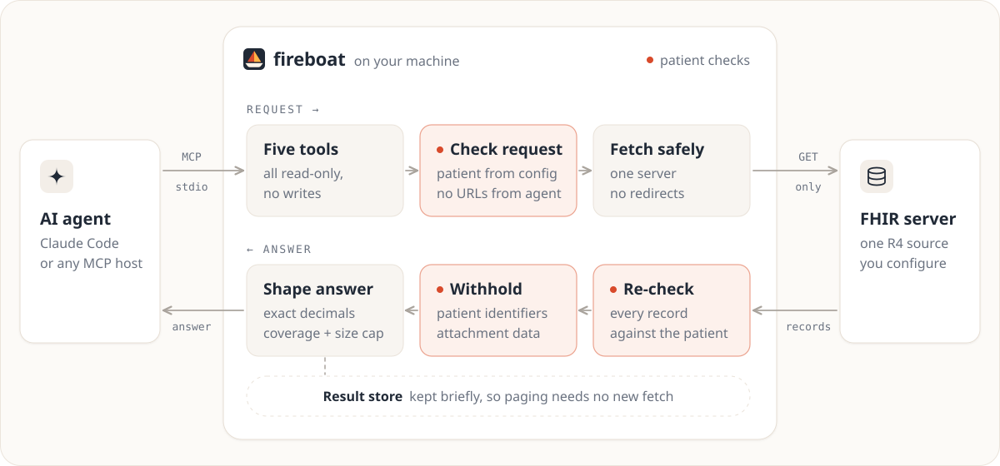

<p align="center">
  
</p>

# fireboat

Give AI agents safe, read-only access to one patient's FHIR health records over MCP.

> **Early preview, not a release.** Uses synthetic (made-up) patient data; benchmarks may also use openly licensed, de-identified research data.
> Runs locally on your own machine. Read-only. No SMART on FHIR sign-in yet; it is planned for version 2, the next version.
> Not clinically validated. Not affiliated with or endorsed by HL7.
> No npm package or release yet.

**Contents:** [What it is](#what-it-is) · [Who it is for](#who-it-is-for) · [Why](#why) · [How it works](#how-it-works) ·
[Try it](#try-it-in-2-minutes) · [Use it with an AI agent](#use-it-with-an-ai-agent) · [The five tools](#the-five-tools) ·
[What a response looks like](#what-a-response-looks-like) · [When something is not allowed](#when-something-is-not-allowed) ·
[Configuration](#configuration) · [Project layout](#project-layout) · [Development and testing](#development-and-testing) ·
[What works today](#what-works-today-and-what-does-not-yet) · [Questions](#questions)

## What it is

fireboat sits between an AI agent, such as Claude Code or Cursor, and a FHIR server, the standard format for electronic health records.
It lets the agent search and read one patient's records through MCP (Model Context Protocol), the standard way AI agents connect to tools.
The patient is chosen by whoever sets fireboat up, never by the AI.
Before anything reaches the AI, fireboat checks that it belongs to that patient and removes what the AI should not see.
Today it focuses on one job: looking up a patient's recent lab results.

## Who it is for

- **Developers building AI agents on FHIR data** who want a worked example of letting an agent read health records without
  letting it wander: a fixed patient, no writes, and answers that say what they could and could not check.
- **People evaluating how AI should handle clinical data**, who want to see where the safety checks sit and run them
  against synthetic data.
- **Anyone curious about MCP** who wants a small, heavily tested server to read and learn from.

It is not for production use or real patients. See [What works today](#what-works-today-and-what-does-not-yet).

## Why

- **One patient, locked in:** the patient is set in configuration, so the AI cannot ask for anyone else. Every record that comes back is checked again.
- **Read-only:** five tools for finding and reading records. Nothing can write, change or delete data.
- **Exact values:** a lab value written as `7.0` stays `7.0`. A number that cannot be kept exactly is refused, never rounded.
- **Honest answers:** every result says what was checked and whether the list may be incomplete.
- **Size limits:** every response has a maximum size, so a large record cannot flood the AI's context.
- **Heavily tested:** automated tests pin each safety rule, and the tests are themselves checked by deliberately breaking the code to make sure they notice.

The [security model](docs/SECURITY-MODEL.md) and [testing guide](docs/TESTING.md) have the details.

## How it works

<picture>
  <source media="(prefers-color-scheme: dark)" srcset="docs/assets/how-it-works-dark.svg">
  
</picture>

1. The AI agent calls one of fireboat's five tools over MCP.
2. fireboat checks the request first. The patient always comes from your configuration, only allowed search filters get through, and the agent can never pass in a web address.
3. fireboat then asks the one FHIR server you configured on your own machine. It does not follow redirects, and it stops responses that are too large or too slow.
4. Everything that comes back is checked against the patient again. Data the AI should not see is removed, numbers keep their exact form, and the answer says how complete it is.
5. Results are kept for a short time, so the agent can page through them without fetching again.

## Try it in 2 minutes

Use Node **24.22.0**, pinned in [`.nvmrc`](.nvmrc), from a checkout.
This demo needs no Docker, API key or AI model.

```sh
npm ci
npm run demo -- --check
```

The demo starts a synthetic FHIR source and a real MCP stdio server, checks them, then cleans up.
Example output:

```text
check ok   tools-listed: listed 5 tools
check ok   capabilities-succeed: synthetic source described
check ok   search-returns-records: 1 record(s)
check ok   search-confined-to-trusted-patient: page 1 carries only the trusted patient's observations
check ok   page-continues: 1 new record(s)
check ok   read-trusted-record: record returned
check ok   cross-patient-read-denied: NOT_FOUND
check ok   result-inspect: 1 retained record(s)
demo check passed (8 outcomes)
```

## Use it with an AI agent

Keep the bundled synthetic source running in one terminal:

```sh
SYNTHETIC_FHIR_PORT=19001 npm run demo:source
```

In another terminal, from the checkout, build and register it with Claude Code:

```sh
npm run build
mkdir -p .local
sed 's/8080/19001/' examples/local.config.json > .local/fireboat.config.json
npm run doctor -- --config "$PWD/.local/fireboat.config.json"
NODE="$(node -p 'process.execPath')"
CLI="$PWD/dist/packages/server/src/cli.js"
CONFIG="$PWD/.local/fireboat.config.json"
claude mcp add --transport stdio --scope local fireboat -- "$NODE" "$CLI" --config "$CONFIG"
```

Restart Claude Code, then ask:
“Show this synthetic patient's recent lab results. Cite the source records and explain any coverage limits.”

**Only Claude Code has been tried as an AI host,** and only with an earlier version of the response format.
The [configuration guide](docs/CONFIGURATION.md) covers ports, CLI options, doctor output and search examples.
Local stdio does not mean the host keeps data on your device; see the [security model](docs/SECURITY-MODEL.md#residuals-and-non-claims).

## The five tools

| Tool | What the agent uses it for | Main inputs |
| --- | --- | --- |
| `fhir_capabilities` | Find out what it can ask: the source, the bound patient, which record types and search filters are supported, and the limits. | `topic`: `server`, `resource`, `context`, `schema`, `search_parameter` or `support` |
| `fhir_search` | Search the patient's records of one type, for example lab results by code or date. | `resource_type`, `params` (a list of `{ "name", "value" }`), `page_size` |
| `fhir_read` | Read one record by type and ID, if it belongs to the patient (or is an allowed shared record; a clinician, organization or location only once the patient's own records name it). | `resource_type`, `id`, `interaction: "read"` |
| `fhir_page` | Get the next page of an earlier search. | `cursor` |
| `fhir_result` | Look again at results already fetched, for example to pick out fields, without asking the server again. | `handle`, `action` |

An example search for the patient's HbA1c results:

```json
{
  "resource_type": "Observation",
  "params": [{ "name": "code", "value": "http://loinc.org|4548-4" }],
  "page_size": 5
}
```

There is no `patient` parameter: the patient is already fixed by configuration, and passing one is refused.
See [tool inputs](docs/CONFIGURATION.md#tool-inputs) and the full [tool contract](docs/contracts/m3b-tools.json).

## What a response looks like

Every tool returns the same shape. This is a real search result from the bundled synthetic source, trimmed for length
(from [`examples/tool-calls.json`](examples/tool-calls.json)):

```jsonc
{
  "data": {
    "resources": [{
      "resourceType": "Observation",
      "id": "synthetic-obs-a1",
      "code": { "coding": [{ "system": "http://loinc.org", "code": "2345-7",
                             "display": "Glucose [Mass/volume] in Serum or Plasma" }] },
      "subject": { "reference": "Patient/synthetic-patient-a" },
      "effectiveDateTime": "2025-01-10T08:00:00.000Z",
      "valueQuantity": { "value": 95, "unit": "mg/dL" }
    }]
  },
  "coverage": {
    "state": "partial",
    "reasons": ["CLINICAL_RECORD_COMPLETENESS_UNKNOWN", "MORE_PAGES"],
    "constraints": [{ "name": "patient", "value": "Patient/synthetic-patient-a",
                      "execution": "gateway_enforced" }]
  },
  "budget": { "bytes_returned": 2168, "byte_limit": 49152, "wire_bytes": 4773, "limit_reached": false },
  "pagination": { "has_more": true, "next_cursor": "cur_..." },
  "provenance": [{ "resource_index": 0, "retrieved_at": "2026-10-19T12:00:00.000Z" }]
}
```

- **`data`** holds the FHIR records, cleaned of anything the AI should not see. Numbers keep the exact text the server sent.
- **`coverage`** tells the agent how far to trust the list. Here it says the list is partial: there are more pages, and
  nobody can promise a FHIR server holds a patient's complete history. It also shows that fireboat itself enforced the
  patient filter.
- **`budget`** shows the response size against its limit (48 KiB by default). The limit counts one copy of the
  response (the larger of the text and structured copies); `wire_bytes` is the whole MCP result, which carries
  that JSON twice.
- **`pagination`** gives an opaque cursor for `fhir_page`. Cursors expire and cannot be built by hand.
- **`provenance`** says where and when each record was fetched, so the agent can cite it.

## When something is not allowed

fireboat refuses rather than guesses. A few examples:

| The agent tries to... | What happens |
| --- | --- |
| Read another patient's record | `NOT_FOUND`, exactly as if the record did not exist, so it cannot even learn that it exists. |
| Add a `patient` search parameter | Refused with `POLICY_DENIED`. |
| Filter by another patient's record, for example `encounter=Encounter/<their id>` | fireboat first runs the same patient-confined search the agent could run itself (`Encounter?_id=<id>&patient=<this patient>`). It finds nothing, so the filter is refused with `POLICY_DENIED`, exactly as for a record that does not exist, and the filtered search is never sent. Filtering by one of the patient's own encounters works. |
| List the clinicians, organizations or locations on the server, or search them by name, address or identifier | Refused with `POLICY_DENIED`, and nothing is sent. A Practitioner, Organization or Location is available only by its ID, by read or `_id` search, once one of the patient's own records already shown names it. Reading one that no such record names gives `NOT_FOUND`, the same whether it exists or not. Medications and code systems can still be searched across the server. |
| Pass a web address or a raw request | Impossible: no tool accepts one. The only server is the one in your configuration. |
| Search on a field that fireboat hides, such as a patient identifier | Refused, so the search cannot be used to guess hidden values. |

And when the FHIR server misbehaves:

| The server... | What happens |
| --- | --- |
| Returns a record for a different patient | The record is dropped before anything reaches the agent. |
| Returns one of this patient's records with a clinician-type reference fireboat cannot verify (for example an identifier only) | That reference is removed and labelled, and the rest of the record is delivered. |
| Returns one of this patient's records that fireboat cannot check for another reason | The record is withheld and the page is marked partial with `RECORDS_WITHHELD_BY_POLICY`. Records withheld because they name another patient are dropped without that signal, so a complete page is still not a complete history. |
| Returns a shared record, such as a Medication, that does not meet the shared-record policy | The record is withheld and the page is marked partial with `SHARED_RECORDS_WITHHELD_BY_POLICY`. Some records are dropped without that signal: one that carries another patient's details (a contained Patient, or a reference to a patient other than this one), and one whose withheld content may describe a person (a Location that is not a listed facility type, such as a home, an Organization with contact persons, or a record carrying a patient or personal identifier such as an MRN or SSN). |
| Redirects the request elsewhere | The redirect is not followed. |
| Sends a number that cannot be kept exactly | The record is refused, never rounded. |
| Sends a response that is too large or too slow | The request is stopped at the size or time limit. |

## Configuration

A minimal configuration, as shipped in [`examples/local.config.json`](examples/local.config.json):

```json
{
  "mode": "synthetic",
  "source": { "alias": "local-synthetic", "baseUrl": "http://127.0.0.1:8080/fhir" },
  "patientId": "synthetic-patient-a",
  "privacy": { "patientIdentifierSystems": ["http://example.invalid/synthetic-mrn"] }
}
```

- `mode` must be `"synthetic"` for now.
- `source.baseUrl` must be a literal local address, such as `127.0.0.1`. The agent only ever sees the `alias`.
- `patientId` is the one patient fireboat will serve.
- `privacy.patientIdentifierSystems` lists the identifier systems to hide from the agent.
- Optional: `privacy.sharedIdentifierSystems` lists product identifier systems that shared Medication records may show
  (empty by default). It can never include a patient identifier system. A listed system also lets an uncoded Medication
  mix whose ingredients only reference other Medication records be shown; see the [security model](docs/SECURITY-MODEL.md#patient-and-shared-instance-checks).
- Optional: `privacy.sharedProfiles` lists the `meta.profile` canonicals that shared records may declare (empty by
  default). Every other shared-record check still applies.
- Optional: `source.auth` for OAuth client credentials (the secret is read from an environment variable you name), and
  `limits` for response size, timeouts and how long results are kept.

Run `npm run doctor -- --config <path>` to check a configuration against its server before you connect an agent.
The [configuration guide](docs/CONFIGURATION.md) lists every field.

## Project layout

| Folder | What is in it |
| --- | --- |
| `packages/core` | The gateway itself: request checks, the HTTP client, patient checks, output shaping, the result store. |
| `packages/server` | The MCP server, the `fireboat` command line and `doctor`. |
| `packages/auth` | Optional OAuth client credentials for the FHIR server. |
| `packages/evals` | The retrieval checks: fixed tasks with known answers, run through a real MCP client. |
| `examples` | The demo, the synthetic FHIR server, example configurations and the HAPI FHIR quickstart helper. |
| `tests` | The automated tests, including the patient-isolation suite. |
| `scripts` | Build, packaging, documentation generators and the mutation-testing tool. |
| `docs` | User guides, limits and the generated reference pages. |
| `bench` | The [benchmark harness](bench/README.md) behind [docs/BENCHMARK.md](docs/BENCHMARK.md), a separate package that is not shipped. |

## Development and testing

```sh
npm run check                            # type check, all tests (a few minutes), build
npm run eval:retrieval                   # retrieval checks, current MCP protocol version
npm run eval:retrieval -- --era legacy   # the same checks, older protocol version
npm run test:isolation                   # patient-isolation suite
node scripts/mutation-guards.mjs --list  # list the deliberate-breakage checks
```

The tests are checked by mutation testing: a tool deliberately breaks a guard in the code, one at a time, and confirms
that a named test fails. A full run takes hours, so contributors usually run a few at a time with `--only <ids>`.
[CONTRIBUTING.md](.github/CONTRIBUTING.md) explains the rules, and [testing and evidence](docs/TESTING.md) has the details.

## What works today, and what does not yet

**Works today** (on an Apple-silicon Mac with Node 24.22.0):
- The demo, the automated tests and the built-in retrieval checks run locally with no Docker, keys or AI model.
- Optional settings let fireboat accept a search page that has no self link when every filter can be checked on the returned records, and follow a server's opaque page tokens; refusals stay the default. This is tested against a synthetic source only ([configuration](docs/CONFIGURATION.md#pages-without-a-self-link)).
- 32 of the 147 FHIR R4 record types are supported, including lab results, conditions, medication requests, administrations and dispenses, specimens, care plans, care teams, imaging studies and devices. Other types are refused, and documents return their details only, not their contents. Device serial numbers and similar production identifiers are withheld from Device records, and DICOM UIDs from imaging study records; the [security model](docs/SECURITY-MODEL.md) lists the residuals. See the [support matrix](docs/SUPPORT-MATRIX.md).
- Clinicians, organizations and locations are available only once one of the patient's own records names them, and only by ID.
- Seven of those types (medication administrations and dispenses, specimens, care plans, care teams, imaging studies and devices) are tested against synthetic test servers only. Against HAPI FHIR they have been exercised only by the benchmark's scripted questions, not by the project's own live check.
- The project's own live check runs against a local HAPI FHIR 8.12.0 server (`npm run test:hapi`, needs Docker).

**Not yet:**
- No use with identifiable or live patient records, no writing to records, no serving over a network, and no SMART on FHIR sign-in.
- Only Apple-silicon Macs with Node 24.22.0 are verified. Linux, Windows and other Node versions are unverified.
- An extra, stricter test suite for patient isolation is still being built. It runs in diagnostic mode and counts no cases yet.
- No independent human security review yet.
- No claim that it saves tokens, time or cost: that has not been measured.

**Benchmark** (scripted tool calls with no AI model, HAPI FHIR 8.12.0, fireboat built from this repository): on 150 questions about a fresh sample of synthetic patients that development never saw, fireboat with default settings answered 148 correctly (149 with operator settings) and the WSO2 fhir-mcp-server 148. On 147 MIMIC questions, data fireboat was developed against, fireboat answered 134 by default (140 with operator settings) and WSO2 147. fireboat returned no other patient's records in 100 probes. The same author wrote both fireboat and the benchmark, so read the [results and caveats](docs/BENCHMARK.md). The harness is in [`bench/`](bench/README.md).

Current results for the tests, the deliberate-breakage checks, the retrieval checks and the isolation suite are in [testing and evidence](docs/TESTING.md).

## Questions

**Can I connect it to a real EHR or real patient data?** Not in this version. It only accepts a local FHIR server and
synthetic mode, and it has no SMART on FHIR sign-in. Use the bundled synthetic server or a local HAPI FHIR server
loaded with the synthetic seed ([quickstart](docs/QUICKSTART.md)).

**Is SMART on FHIR support coming?** Yes. SMART on FHIR sign-in is planned for version 2, the next version. Until it
ships, nothing in this version should be read as SMART support.

**Does my data stay on my machine?** fireboat itself runs locally and only talks to the server you configure. But the AI
host you connect it to may send tool results to its model provider. That is up to the host, not fireboat.
See the [security model](docs/SECURITY-MODEL.md#residuals-and-non-claims).

**Why only one patient?** It keeps the safety rule simple and checkable: the agent cannot reach anyone else, whatever it
asks for.

**Which AI hosts work?** Only Claude Code has been tried, with an earlier version of the response format.

**Do I need Docker?** No. The demo and the bundled synthetic server need only Node. Docker is only for the optional HAPI
FHIR quickstart and the live checks.

**Was AI used to build it?** fireboat was built with the help of AI coding assistants, and AI models were used to review
parts of the code and the benchmark; the tests and gates described in [docs/TESTING.md](docs/TESTING.md) are the evidence
for how it behaves.

## Learn more

- [Configuration and command-line options](docs/CONFIGURATION.md), [size and time limits](docs/LIMITS.md), [security model](docs/SECURITY-MODEL.md).
- [Testing and evidence](docs/TESTING.md), [benchmark results](docs/BENCHMARK.md) and the [benchmark harness](bench/README.md).
- [Which record types are supported](docs/SUPPORT-MATRIX.md), [how searches are checked](docs/QUERY-EVIDENCE.md), [how failed searches are explained](docs/QUERY-REPAIR.md).
- [Compact output formats](docs/COMPACT-PROFILES.md) and [notes on AI hosts](docs/HOST-PROFILES.md).
- [Running it against a local HAPI FHIR server](docs/QUICKSTART.md) (needs Docker).
- [Contributing](.github/CONTRIBUTING.md), [code of conduct](.github/CODE_OF_CONDUCT.md), [instructions for coding agents](AGENTS.md), [security policy](.github/SECURITY.md).

Issues and pull requests are welcome. Include your platform, Node version, command and output with testing feedback.
Report security issues privately through the [security policy](.github/SECURITY.md).
Do not submit real or de-identified patient data (including benchmark data) or credentials.

## License

Apache License 2.0. See [LICENSE](LICENSE), [NOTICE](NOTICE) and [THIRD_PARTY_NOTICES.md](packaging/THIRD_PARTY_NOTICES.md).

**Third-party content:** the synthetic test data contains content from LOINC and records generated with Synthea. The LOINC notice and other credits are in [packaging/licenses/SEED_NOTICES.md](packaging/licenses/SEED_NOTICES.md). Benchmark datasets are not included: they are downloaded at run time and cited in [testing and evidence](docs/TESTING.md#benchmarks-and-research-data).

HL7® and FHIR® are registered trademarks of Health Level Seven International. Their use here does not constitute endorsement by HL7.
